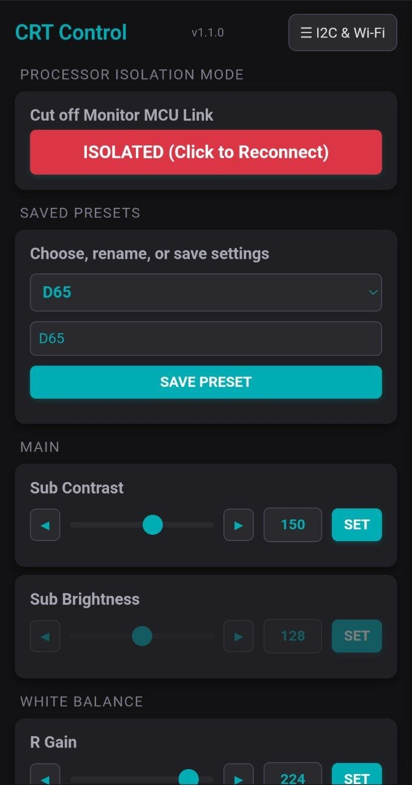
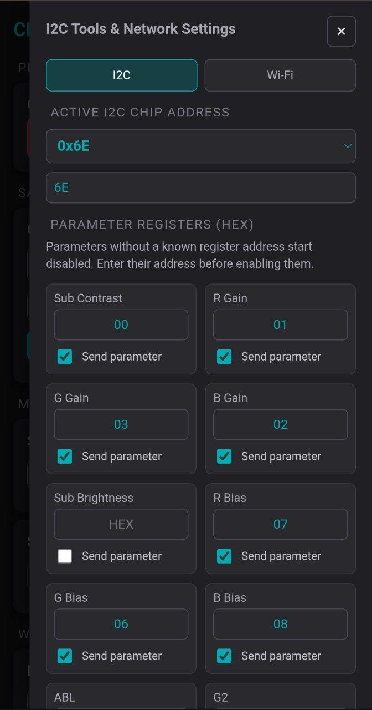
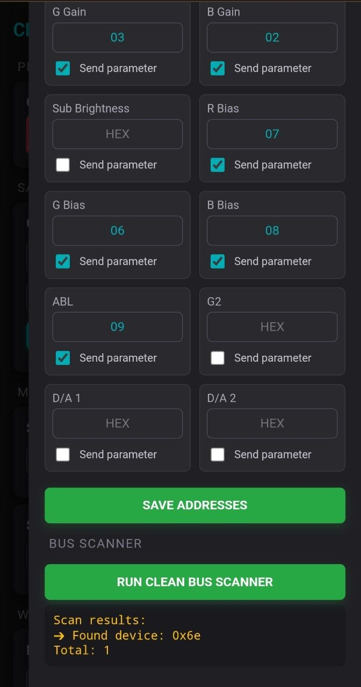
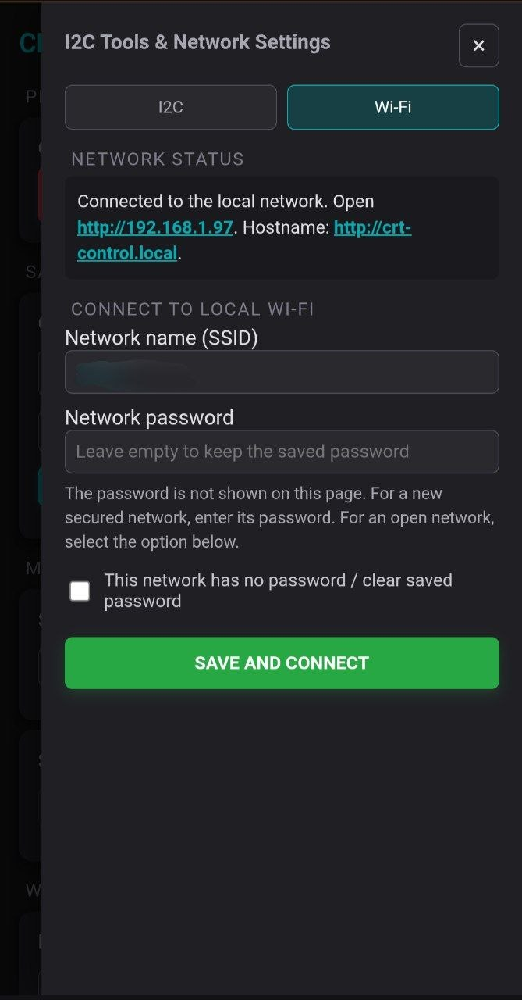

# CRT Iso-Controller

[English version](README.md)

Прошивка для ESP32, позволяющая управляять предусилителем ЭЛТ монитора по шине I²C. 

## Возможности
- **12 настраиваемых параметров**: Управление суб-контрастом, гейнами, биасами и другими параметрами.
- **Универсальная карта регистров**: Адрес чипа и адреса регистров задаются в веб-интерфейсе, что позволяет работать с разными чипами.
- **Безопасность**: Флаги включения на каждый параметр предотвращают случайную запись в неизвестные регистры.
- **3 сохраненных пресета**: Сохранение и загрузка всех параметров в энергонезависимую память (NVS).
- **Аппаратная изоляция**: Управление коммутатором для отключения MCU монитора от шины I²C.
- **Сетевые возможности**: Подключение к домашней сети Wi-Fi (с поддержкой mDNS `crt-control.local`) или использование встроенной резервной точки доступа.
- **Сканер шины I²C**: Встроенный инструмент для поиска устройств на шине.

## Подключение
| Сигнал             | GPIO ESP32 |
| ------------------ | ---------- |
| I²C SDA            | 21         |
| I²C SCL            | 22         |
| Контроль изоляции  | 4          |

**Примечания:**
- Линии I²C требуют подтягивающих резисторов (обычно уже есть на стороне монитора).

## Необходимые библиотеки 
Откройте Arduino IDE, перейдите в **Sketch → Include Library → Manage Libraries...** и установите:
1. **`ESPAsyncWebServer`** (от ESP32Async или me-no-dev)
2. **`AsyncTCP`** (от ESP32Async или me-no-dev)

## Установка
1. Установите [ESP32 Arduino Core](https://github.com/espressif/arduino-esp32) (версия 2.0 или новее).
2. Установите библиотеки, указанные выше.
3. Откройте `firmware/CRT_Iso_Controller/CRT_Iso_Controller.ino` в Arduino IDE.
4. **Важный шаг:** Выполните `Tools → Erase Flash → All Flash Contents`. Это обязательно при первой прошивке для очистки старых конфигурационных данных.
5. Выберите плату ESP32 и нажмите **Upload**.

## Первый запуск и настройка сети
1. Включите ESP32. После 3-секундной задержки она запустится в режиме **Точки доступа (AP)**.
2. Подключитесь телефоном или ПК к Wi-Fi сети **`CRT-Control`** (Пароль: **`12345678`**).
3. Откройте в браузере **`http://192.168.4.1`**.
4. По умолчанию устройство находится в режиме **Connected**. Перейдите в **☰ Меню (справа вверху) → вкладка I2C**, для конфигурации адресов. Переключите в **Isolated**, чтобы разблокировать управление параметрами.
5. Перейдите в **☰ Меню (справа вверху) → вкладка Wi-Fi**, чтобы подключить ESP32 к вашей домашней сети. После подключения интерфейс будет доступен по адресу `http://crt-control.local`.

## Обзор веб-интерфейса
### Главный экран
- **Управление изоляцией**: При подключении MCU к предусилителю (Connected) элементы управления блокируются во избежание случайных записей.
- **Сохраненные пресеты**: Выберите слот из выпадающего списка для мгновенного применения или сохраните текущие настройки.
- **Карточки параметров**: Используйте ползунки, кнопки шага или числовой ввод (0–255) для изменения значений.
<p align="center">
  
</p>

### Меню настроек (☰)
- **Вкладка I²C**: Введите HEX-адреса регистров для необходимых параметров и поставьте галочку *Send parameter*, не забудьте сохранить. Используйте **Сканер шины** для проверки адреса предусилителя.
<p align="center">
  
  
</p>

- **Вкладка Wi-Fi**: Управление учетными данными сети и просмотр статуса подключения.
<p align="center">
  
</p>

## Безопасность и рекомендации
- **Не пишите в неизвестные регистры**: Не записывайте данные в регистр, не убедившись в его назначении по даташиту.
- **`crt-control.local` не открывается:** Если по IP-адресу всё работает, а по имени нет, проверьте, не включен ли у вас **VPN**. VPN часто перехватывает локальные DNS/mDNS-запросы. Отключите VPN или используйте прямой IP-адрес.
- **Зависание при открытии многих вкладок:** У ESP32 ограниченное количество сокетов. Прошивка принудительно закрывает соединения, но избегайте открытия более 3-4 вкладок одновременно.

## Схема подключения

```text
┌─────────────────────────────────────────────────────────────────────────────┐
│                                  MONITOR                                    │
│                                                                             │
│   ┌───────────────────┐                                   ┌─────────────┐   │                         
│   │        MCU        │                                   │   PRE-AMP   │   │
│   │                   │                                   │             │   │
│   │ OUT:              │                 \ /               │ IN:         │   │
│   │ • [SDA_MCU]       │──────────────────x────────────────│ • [SDA_AMP] │   │
│   │ • [SCL_MCU]       │                 / \               │ • [SCL_AMP] │   │
│   └───────────────────┘                                   │             │   │
│     • [5V]                                                │             │   │
│     • [GND]                                               └─────────────┘   │
└─────────────────────────────────────────────────────────────────────────────┘
           │                                                       ▲
           │                                                       │ • Via 47–100 Ω resistors (usually already present on the board)
           ▼                                                       │
┌─────────────────────────────────────────────────────────────────────────────┐
│                                    CD4066                                   │
│                                                                             │
│   Power:                                                                    │
│   • VCC ◄────────────── [5V] (from the monitor)                             │
│   • GND ◄────────────── [GND] (from the monitor)                            │
│                                                                             │
│   Control:                                                                  │
│   • CTRL (A, B) ◄────── [GPIO_4] (from ESP32)                               │◄─┐
│                                                                             │  │
│   Switching:                                                                │  │
│   • IN A ◄───────────── [SDA_MCU]       OUT A ─────────────► [SDA_AMP]      │  │
│   • IN B ◄───────────── [SCL_MCU]       OUT B ─────────────► [SCL_AMP]      │  │
│                                                                             │  │
│                                                                             │  │
│                                         OUT A ◄───────────── [SDA_5V]       │  │
│                                         OUT B ◄───────────── [SCL_5V]       │  │
└─────────────────────────────────────────────────────────────────────────────┘  │
           │                                                       ▲             │
           │                                                       │             │
           ▼                                                       │             │
┌─────────────────────────────────────────────────────────────────────────────┐  │
│                            Logic Level Converter                            │  │
│                                                                             │  │
│   5V side (HV):                        3.3V side (LV):                      │  │
│   • HV_VCC ◄── [5V] (from the monitor) • LV_VCC ◄────── [3.3V] (from ESP32) │  │
│   • HV_GND ◄── [GND] (from the monitor)• LV_GND ◄────── [GND] (from ESP32)  │  │
│   • HV_SDA ───► [SDA_5V] (to CD4066)   • LV_SDA ◄────── [SDA_ESP]           │  │
│   • HV_SCL ───► [SCL_5V] (to CD4066)   • LV_SCL ◄────── [SCL_ESP]           │  │
└─────────────────────────────────────────────────────────────────────────────┘  │ 
           │                                                       ▲             │
           │                                                       │             │
           ▼                                                       │             │
┌─────────────────────────────────────────────────────────────────────────────┐  │
│                                   ESP32                                     │  │
│                                                                             │  │
│   Power:                                                                    │  │
│   • VIN ◄────────────── [5V] (from the monitor or power supply unit)        │  │
│   • GND ◄────────────── [GND] (from the monitor or power supply unit)       │  │ 
│                                                                             │  │
│   Signal:                                                                   │  │
│   • GPIO 4 ───────────► [GPIO_4] (to the CD4066)                            │──┘
│   • SDA (Pin 21) ─────► [SDA_ESP] (to the LLC)                              │
│   • SCL (Pin 22) ─────► [SCL_ESP] (to the LLC)                              │
│   • 3.3V ─────────────► [3.3V] (to the LLC)                                 │
│   • GND ──────────────► [GND] (to the LLC)                                  │
└─────────────────────────────────────────────────────────────────────────────┘
```

## Лицензия
Лицензия MIT. Подробности в файле [LICENSE](LICENSE).
